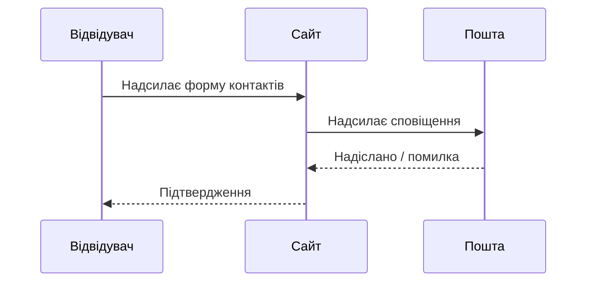

# Шаблон C. Модульний стиль OpenSpec / BMAD

Використовуйте **модулі** або **пакети** з ID. Кожен блок має бути самодостатнім для простежуваності.

---

## Метадані пакета

| Поле | Значення |
|------|----------|
| ID пакета | PKG-CONTACT-001 |
| Можливість (capability) | Форма контактів |
| Статус | Відкриття |
| Власник | |

---

## Модуль 1. Місія й результат (стиль BMAD)

**Місія:**  
**Бажаний результат:**  
**Критерії успіху:**

| ID | Критерій | Спостережуваний сигнал |
|----|----------|------------------------|
| SC-01 | | |

---

## Модуль 2. Межі (стиль OpenSpec)

### У межах

| ID | Пункт |
|----|-------|
| IN-01 | |

### Виключення

| ID | Виключення | Причина |
|----|------------|---------|
| OUT-01 | | |

---

## Модуль 3. Актори й потік

| Актор | Роль |
|-------|------|
| | |

---

## Модуль 4. Бізнес-правила (перевірювані)

| ID | Коли | Тоді | Інакше |
|----|------|------|--------|
| RULE-01 | | | |
| RULE-02 | | | |

---

## Модуль 5. Обмеження й залежності

| ID | Тип | Опис |
|----|-----|------|
| DEP-01 | | |
| CON-01 | Юридичне / політика | |

---

## Модуль 6. Припущення й відкриті питання

| ID | Припущення | План перевірки |
|----|------------|----------------|
| ASM-01 | | |

| ID | Питання | Стейкхолдер |
|----|---------|-------------|
| Q-01 | | |

---

## Матриця простежуваності (стартова)

| ID правила | Пов'язаний AC / історія | Ідея тесту |
|------------|-------------------------|------------|
| RULE-01 | | |

---

**Рефлексія:** Який модуль першим виявив прогалини щодо **зберігання даних** чи **обіцянок стейкхолдерів**? Чи міг би дизайнер прочитати лише Модуль 3 і все одно узгодитися?
