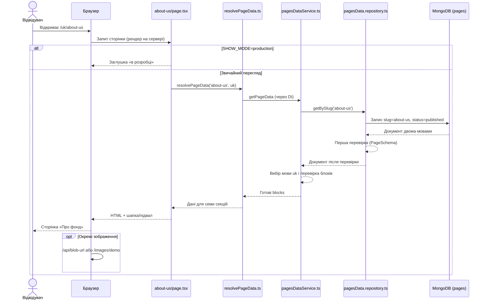

# Фіча «Про фонд»

Тут зібрано, як працює публічна сторінка «Про фонд»: для кого вона, що має показувати і звідки береться текст у навчальній копії сайту. Документ орієнтований на BA, PM і стейкхолдерів.

## Короткий опис фічі

Сторінка «Про фонд» відкривається за адресами `/uk/about-us` та `/en/about-us`. На ній — місія, цілі, команда й напрями роботи Фонду ім. Бориса Лятошинського.

Тексти зберігаються в базі (у локальному навчанні це тимчасова MongoDB в пам’яті). Сторінка збирається на сервері, і лише потім потрапляє в браузер. Через сайт контент не редагується: відвідувач бачить уже опубліковану версію тією мовою, яку обрав.

## User stories

### US-1: Перегляд сторінки двома мовами

Як відвідувач сайту, я хочу відкрити сторінку «Про фонд» українською або англійською, щоб читати про фонд зручною для мене мовою.

**Acceptance Criteria:**

1. Сторінка відкривається за адресами `/uk/about-us` та `/en/about-us`.
2. Заголовки, тексти й підписи до зображень у блоках відповідають мові в адресі (`uk` або `en`).
3. Якщо для обраної мови немає перекладу в даних сторінки, користувач бачить зрозумле повідомлення про помилку, а не змішані мови в одному блоці.

### US-2: Ознайомлення з ключовими блоками про фонд

Як відвідувач сайту, я хочу побачити структуровану розповідь про фонд (вступ, місія, цілі, діяльність, засновників), щоб швидко зрозуміти, хто ми і чим займаємося.

**Acceptance Criteria:**

1. На сторінці є секції: вступ, інформація про організацію, місія, цілі, офіс Лятошинського, «що ми робимо», засновники — якщо вони заповнені в CMS (системі керування контентом).
2. Форматований текст (списки, абзаци з редактора TipTap) відображається коректно, без «зламаної» верстки.
3. Зображення й цитати показуються з підписами, коли ті задані в даних.

### US-3: Навігація до архіву з блоку про офіс

Як відвідувач сайту, я хочу перейти до архіву з секції про офіс Лятошинського, щоб продовжити ознайомлення з матеріалами фонду.

**Acceptance Criteria:**

1. У блоці про офіс є кнопка переходу в архів.
2. Посилання веде на архів тією ж мовою, що й решта сайту.
3. Підписи кнопки й статичні рядки в блоці офісу беруться з перекладів інтерфейсу; цитата в блоці — з контенту сторінки в базі.

### US-4: Робота в навчальному (демо) режимі

Як учасник курсу або тестувальник, я хочу після локального запуску проєкту одразу бачити сторінку з демо-даними, щоб перевіряти поведінку без окремої бази.

**Acceptance Criteria:**

1. Після `npm run dev` сторінка «Про фонд» показує демо-контент без ручного імпорту (дані підставляє скрипт при старті).
2. Після перезапуску застосунку локальні зміни в базі з попереднього сеансу не зберігаються — знову підвантажуються демо-дані.
3. Якщо увімкнено режим «як у продакшені» (`SHOW_MODE=production`), замість контенту показується заглушка «в розробці».

### US-5: Пошук і SEO

Як відвідувач із пошукової системи, я хочу бачити змістовний заголовок у вкладці браузера, щоб відрізнити цю сторінку від інших розділів.

**Acceptance Criteria:**

1. У вкладці браузера — локалізовані title і description для «Про фонд» (з файлів перекладів метаданих).
2. Працюють шапка, підвал і перемикач мови, як на інших сторінках сайту.

## Потік даних

Контент сторінки читається на сервері за один прохід; окремий HTTP API для «Про фонд» не потрібен. Меню й контакти в шапці та підвалі layout підтягує з інших записів бази (`app/[lang]/layout.tsx`).

## Ключові файли

| Що описує | Шлях |
|-----------|------|
| Маршрут і збірка блоків на екрані | `app/[lang]/about-us/page.tsx` |
| Точка входу для CMS-даних на сервері | `app/services/pages-data/resolvePageData.ts` |
| Завантаження, локалізація, перевірка сторінки | `app/services/pages-data/pagesDataService.ts` |
| Вибір схеми за slug | `app/services/pages-data/schema-factory.ts` |
| Читання з бази за slug | `app/infrastructure/repositories/pages-data/pagesData.repository.ts` |
| Структура та обов’язкові блоки «Про фонд» | `app/validators/pagesSchemas/pages/about-us.schema.ts` |
| Демо-дані при старті | `scripts/seed-memory-mongo.js` |
| Блок офісу (кнопка в архів) | `app/shared/components/blocks/Liatoshynsky-office/LiatoshynskyOffice.tsx` |
| Заглушка «в розробці» | `app/lib/utils/isProductionMode.ts` |

## Відкриті питання

1. Метадані: чи canonical URL має вказувати на `/about-us`, а не на головну? Зараз у `generateMetadata` стоїть `ROUTES.HOME`.
2. Чи потрібен зручний перегляд чернеток «Про фонд» для контент-менеджерів у навчальному проєкті? Нині це зав’язано на draft mode у Next.js.
3. Хто зі стейкхолдерів затверджує повний набір із семи секцій для продакшену? У моделі даних усі вони обов’язкові.
4. Чи лишаємо заглушку при `SHOW_MODE=production` для зовнішніх демо, чи показуємо повний контент?
