# Архітектура застосунку

Документ показує, як основні сторінки Next.js отримують дані: частина маршрутів викликає HTTP API з клієнта, інші — серверні компоненти через `app/di/container.ts` і сервіси без проміжного API. Діаграма зводить ланцюжки до реальних папок і файлів у `app/[lang]/`, `app/api/`, `app/services/` та `app/infrastructure/`.

```mermaid
flowchart TD
  subgraph di["app/di/"]
    CONTAINER["container.ts"]
    MOD_REPO["modules/repositories.module.ts"]
    MOD_SVC["modules/composedServices.module.ts"]
    CONTAINER --> MOD_REPO
    CONTAINER --> MOD_SVC
  end

  subgraph pages["app/[lang]/ — сторінки"]
    P_HOME["page.tsx"]
    P_ABOUT["about-us/page.tsx"]
    P_BIO["biography/page.tsx"]
    P_ART["artistry/page.tsx"]
    P_RES["research/page.tsx"]
    P_ARCH["archive/page.tsx"]
    P_ARCH_CASE["archive/[fund]/[case]/page.tsx"]
    P_NEWS["news/page.tsx"]
    P_COOP["cooperation/page.tsx"]
    P_CONTACTS["contacts/page.tsx"]
    P_SUPPORT["support-us/page.tsx"]
    P_PRIV["privacy-policy/page.tsx"]
    P_WAR["war-in-ukraine/page.tsx"]
    P_TERMS["terms/page.tsx"]
    P_ARCH_FUND["archive/[fund]/page.tsx"]
  end

  subgraph layout["Спільні серверні компоненти"]
    HDR["shared/components/Header/Header.server.tsx"]
    FTR["shared/components/Footer/Footer.tsx"]
    NEWS_SEC["shared/components/blocks/news-section/NewsSection.tsx"]
    MUSIC_TBL["shared/components/tables/CompositionTable/MusicTableSection.tsx"]
    WORK_TBL["shared/components/tables/WorksTable/WorkTableSection.tsx"]
    COOP_FORM["shared/components/forms/offer-collaboration-form/OfferCollaborationForm.tsx"]
  end

  subgraph api["app/api/ — маршрути"]
    API_FUNDS["funds/route.ts"]
    API_COMP_D["compositions/data/route.ts"]
    API_COMP_F["compositions/filters/route.ts"]
    API_COMP_T["compositions/titles/route.ts"]
    API_SCI_D["scientific-works/data/route.ts"]
    API_SCI_F["scientific-works/filters/route.ts"]
    API_SCI_T["scientific-works/titles/route.ts"]
    API_COLLAB["collaboration/route.ts"]
    API_BLOB["blob-url/route.ts"]
    API_PAGE["page/route.ts"]
    API_HEADER["header/route.ts"]
  end

  subgraph rsc["Серверний шар без HTTP API"]
    RESOLVE["services/pages-data/resolvePageData.ts"]
  end

  subgraph services["app/services/"]
    S_PAGES["pages-data/pagesDataService.ts"]
    S_DRAFT["pages-data/pagesDataService.ts<br/>(draftPagesDataService)"]
    S_HEADER["header/headerService.ts"]
    S_FOOTER["footer/footerService.ts"]
    S_ARTISTRY["artistry/artistryService.ts"]
    S_SCIENCE["scientific-works/scientificWorks.ts"]
    S_FUNDS["funds/fundsService.ts"]
    S_NEWS["news/newsService.ts"]
    S_MEDIA["media-mentions/mediaMentionService.ts"]
    S_CLIENT["client/tableService.ts"]
  end

  subgraph repos["app/infrastructure/repositories/"]
    R_PAGES["pages-data/pagesData.repository.ts"]
    R_NAV["navigation/navigation.repository.ts"]
    R_FOUND["foundation-info/foundationInfo.repository.ts"]
    R_COMP["artistry/compositions.repository.ts"]
    R_SCI["scientific-works/scientificWorks.repository.ts"]
    R_FUNDS["funds/funds.repository.ts"]
    R_NEWS["news/news.repository.ts"]
    R_MEDIA["media-mentions/mediaMention.repository.ts"]
  end

  subgraph models["app/infrastructure/models/"]
    M_PAGES["pages/pages.ts<br/>pages/draftPages.model.ts"]
    M_NAV["navigation/navigation.ts"]
    M_FOUND["foundation-info/"]
    M_ART["artistry/"]
    M_SCI["scientific-works/"]
    M_ARCH["archive/Fund.ts<br/>archive/Case.ts"]
    M_NEWS["news/news.model.ts"]
    M_MEDIA["media-mentions/mediaMention.model.ts"]
  end

  MOD_REPO -.-> repos
  MOD_SVC -.-> services

  P_HOME --> RESOLVE
  P_ABOUT --> RESOLVE
  P_BIO --> RESOLVE
  P_RES --> RESOLVE
  P_PRIV --> RESOLVE
  RESOLVE --> CONTAINER
  RESOLVE --> S_PAGES
  RESOLVE --> S_DRAFT
  S_PAGES --> R_PAGES
  S_DRAFT --> R_PAGES
  R_PAGES --> M_PAGES

  P_COOP --> CONTAINER
  P_COOP --> S_PAGES
  P_ARCH_CASE --> CONTAINER
  P_ARCH_CASE --> S_FUNDS

  P_NEWS --> CONTAINER
  P_NEWS --> S_NEWS
  P_NEWS --> S_MEDIA
  S_NEWS --> R_NEWS
  S_MEDIA --> R_MEDIA
  R_NEWS --> M_NEWS
  R_MEDIA --> M_MEDIA

  P_CONTACTS --> CONTAINER
  P_SUPPORT --> CONTAINER
  P_CONTACTS --> S_FOOTER
  P_SUPPORT --> S_FOOTER
  HDR --> CONTAINER
  FTR --> CONTAINER
  HDR --> S_HEADER
  HDR --> S_FOOTER
  FTR --> S_FOOTER
  S_HEADER --> R_NAV
  S_HEADER --> R_FOUND
  S_FOOTER --> R_NAV
  S_FOOTER --> R_FOUND
  R_NAV --> M_NAV
  R_FOUND --> M_FOUND

  P_HOME --> NEWS_SEC
  NEWS_SEC --> CONTAINER
  NEWS_SEC --> S_NEWS

  P_ARCH --> API_FUNDS
  API_FUNDS --> CONTAINER
  API_FUNDS --> S_FUNDS
  S_FUNDS --> R_FUNDS
  R_FUNDS --> M_ARCH

  P_ART --> MUSIC_TBL
  P_RES --> WORK_TBL
  MUSIC_TBL --> S_CLIENT
  WORK_TBL --> S_CLIENT
  S_CLIENT --> API_COMP_D
  S_CLIENT --> API_COMP_F
  S_CLIENT --> API_COMP_T
  S_CLIENT --> API_SCI_D
  S_CLIENT --> API_SCI_F
  S_CLIENT --> API_SCI_T
  MUSIC_TBL --> API_BLOB

  API_COMP_D --> CONTAINER
  API_COMP_F --> CONTAINER
  API_COMP_T --> CONTAINER
  API_SCI_D --> CONTAINER
  API_SCI_F --> CONTAINER
  API_SCI_T --> CONTAINER
  API_COMP_D --> S_ARTISTRY
  API_COMP_F --> S_ARTISTRY
  API_COMP_T --> S_ARTISTRY
  API_SCI_D --> S_SCIENCE
  API_SCI_F --> S_SCIENCE
  API_SCI_T --> S_SCIENCE
  S_ARTISTRY --> R_COMP
  S_SCIENCE --> R_SCI
  R_COMP --> M_ART
  R_SCI --> M_SCI

  P_COOP --> COOP_FORM
  COOP_FORM --> API_COLLAB

  P_BIO --> API_BLOB
  P_HOME --> API_BLOB

  API_HEADER --> CONTAINER
  API_HEADER --> S_HEADER
  API_PAGE --> CONTAINER
  API_PAGE --> S_PAGES
```

