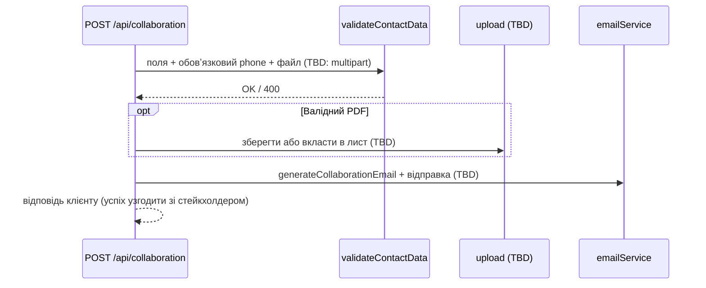

# Фіча «Контактна форма» (issue #2)

Документ описує форму звернення до фонду на сторінках **Контакти** та **Співпраця**, поточну реалізацію в навчальній копії проєкту та цільові зміни з [GitHub issue #2](https://github.com/VovaD199/SDDwithAI26-Vova2/issues/2). Орієнтовано на BA, PM і стейкхолдерів.

## 1. Короткий опис фічі та вимоги з issue

Відвідувач може надіслати запит із іменем, email, повідомленням і (за бажанням) номером телефону, після згоди з політикою конфіденційності. Спільний компонент форми (`ContactForm`) використовується на публічних сторінках через обгортку `OfferCollaborationForm`, яка відправляє дані на **`POST /api/collaboration`**.

**Поточна поведінка в коді (до реалізації #2):**

- Телефон **необов’язковий** на клієнті (Zod дозволяє порожній рядок) і на сервері (`validateContactData` перевіряє телефон лише якщо поле передано).
- Запит — лише **JSON**; поля файлу немає.
- API **не** викликає поштовий сервіс; у відповіді collaboration — демо-повідомлення про прийняття заявки.
- Маршрут `POST /api/contact` з тією ж валідацією існує, але **UI його не викликає**.
- Окремого API для завантаження файлів немає; `uploadService` у демо — заглушка (нічого не зберігає).

**Вимоги з issue #2 (ціль):**

1. Зробити **обов’язковим** номер телефону у формі звернення.
2. Додати **необов’язкове** вкладення (CV / портфоліо): **лише PDF**, до **5 МБ** (точне визначення розміру — у відкритих питаннях).
3. Увімкнути **сповіщення на email**, які відображають нові дані (телефон і вкладення — як файл або посилання; спосіб — у відкритих питаннях).

Сторінки: `/{lang}/contacts` та `/{lang}/cooperation` (`lang`: `uk` | `en`). Додатково той самий `ContactForm` з’являється в модалці «Отримати ноти» без виклику API (інший сценарій).

## 2. User stories

### US-1: Надіслати звернення з контактної сторінки

Як відвідувач сайту, я хочу заповнити форму на сторінці контактів і надіслати повідомлення фонду, щоб отримати відповідь без дзвінка чи листа в поштовий клієнт вручну.

**Acceptance Criteria:**

1. Форма доступна за адресами `/uk/contacts` та `/en/contacts` (блок із `OfferCollaborationForm`).
2. Після успішного сабміту користувач бачить модальне підтвердження (рядки з `contactForm.confirmation` у `i18n/messages`).
3. Під час відправки кнопка та поля тимчасово недоступні (`disabled` через `isSubmitting` у `OfferCollaborationForm`).

### US-2: Надіслати пропозицію співпраці

Як відвідувач, я хочу надіслати той самий тип форми зі сторінки співпраці, щоб пропозиція потрапила в той самий канал обробки.

**Acceptance Criteria:**

1. На `/uk/cooperation` та `/en/cooperation` використовується той самий `ContactForm` через `ContactsInfo` / `OfferCollaborationForm`.
2. Правила полів і сабміт узгоджені з US-1.

### US-3: Обов’язковий телефон (issue #2)

Як відвідувач, я хочу вказати дійсний номер телефону, щоб фонд міг швидко зв’язатися зі мною.

**Acceptance Criteria:**

1. Без валідного телефону сабміт блокується на клієнті та на сервері.
2. Допустимий формат узгоджений із `app/constants/validation.ts`: рядок `^\+\d+$`, довжина **11–16** символів (разом із `+`).
3. Маска вводу на UI може нормалізувати номер до вигляду на кшталт `+380631164627` при успішному сабміті (згідно з існуючою логікою `ContactForm`).

### US-4: Додати CV / портфоліо (issue #2)

Як відвідувач, я хочу за бажанням додати PDF, щоб показати досвід разом із повідомленням.

**Acceptance Criteria:**

1. Поле файлу **необов’язкове**; дозволений лише PDF до **5 МБ** (деталі — відкриті питання).
2. Невалідний тип або розмір блокується з зрозумілими повідомленнями українською / англійською (нові рядки i18n після погодження текстів).

### US-5: Сповіщення команді (issue #2)

Як співробітник фонду, я хочу отримати email із даними форми та телефоном, а за наявності файлу — вкладенням або посиланням, щоб обробити звернення.

**Acceptance Criteria:**

1. Після успішної валідації та реалізації #2 викликається генерація листа (`generateCollaborationEmail` / `emailService` — зараз не підключено з API).
2. У листі завжди є ім’я, email, **телефон**, текст повідомлення; при файлі — вкладення або посилання (спосіб — у відкритих питаннях).

### US-6: Згода з політикою конфіденційності

Як відвідувач, я хочу явно погодитися з політикою перед надсиланням, щоб фонд міг законно обробляти персональні дані.

**Acceptance Criteria:**

1. Без галочки policy сабміт блокується на клієнті (повідомлення `policyRequired` у `uk` / `en`).
2. Посилання веде на `/{lang}/privacy-policy`.
3. Після закриття модалки підтвердження форма скидається, `policy` знову **false** (поточна логіка `ContactForm`).

## 3. Діаграма послідовності потоку даних

### Потік сьогодні (код у репозиторії)

```mermaid
sequenceDiagram
  actor U as Відвідувач
  participant CF as ContactForm (клієнт)
  participant OCF as OfferCollaborationForm
  participant API as POST /api/collaboration
  participant VR as validateRequestData
  participant VC as validateContactData

  U->>CF: Заповнює імʼя, email, повідомлення, policy; телефон опційно
  U->>CF: Натискає «Надіслати»
  CF->>CF: Zod + маска телефону (onChange)
  CF->>OCF: onSubmit (без policy в API-тілі)
  OCF->>OCF: isSubmitting = true → disabled
  OCF->>API: fetch JSON { name, email, phoneNumber?, message }
  API->>VR: parse body
  VR->>VC: validateContactData
  alt Помилки валідації
    VC-->>API: errors (англійські рядки з constants/errors)
    API-->>OCF: 400 { success: false, errors }
    OCF-->>CF: console.error; isSubmitting = false
  else OK
    VC-->>API: value
    API-->>OCF: 200 + demo message (без email)
    OCF-->>CF: isSubmitting = false
    CF-->>U: модалка підтвердження
  end
```

Поле `policy` не передається на сервер. `emailService` і `uploadService` у цьому ланцюжку **не** беруть участі.

### Ціль після issue #2 (узгоджено на рівні вимог, деталі реалізації — TBD)



## 4. Таблиця правил

| Правило | Файл | Джерело істини | Шар |
|--------|------|----------------|-----|
| Імʼя: 2–50 символів, trim | `ContactForm.tsx` (Zod), `validateContactData.ts` | `lengths.NAME_*` у `validation.ts` | UI + API |
| Email: формат за regex | `ContactForm.tsx`, `validateContactData.ts` | `regex.EMAIL_PATTERN` | UI + API |
| Телефон **зараз опційний**; довжина/формат якщо передано | `ContactForm.tsx` (`z.literal('')`, `optional`), `validateContactData.ts` (`if (phoneNumber)`) | `PHONE_NUMBER_*`, `PHONE_NUMBER_PATTERN` | UI + API |
| Телефон **після #2 — обовʼязковий** (ціль issue) | Узгодити зміни в тих самих файлах + тестах | issue #2, `validation.ts` | UI + API |
| Повідомлення: 10–1000 символів | `ContactForm.tsx`, `validateContactData.ts` | `MESSAGE_*` | UI + API |
| Policy: обовʼязкова лише на клієнті | `ContactForm.tsx` (`policy` refine); не в `ContactFormData` API | Zod + `i18n` `policyRequired` | UI |
| Нормалізація телефону з маски при сабміті | `ContactForm.tsx`, `normalizePhoneNumberFromMask.ts` | Логіка маски / hook `useHandlePhoneInput` | UI |
| Сабміт зі сторінок контактів/співпраці → `/api/collaboration` | `OfferCollaborationForm.tsx` | Єдиний `fetch` у формі | UI |
| Серверна валідація contact-полів | `app/api/collaboration/route.ts`, `app/api/contact/route.ts` | `validateContactData` | API |
| Демо-відповідь collaboration без email | `collaboration/route.ts` | Поточний route handler | API |
| Тексти полів і помилок UI | `i18n/messages/uk.json`, `en.json` → `contactForm` | next-intl | i18n |
| Англомовні помилки API | `app/constants/errors.ts` | `NAME_ERROR`, `EMAIL_ERROR`, `PHONE_NUMBER_ERROR`, `MESSAGE_ERROR` | API |
| Шаблон листа (блок Phone умовний, якщо phone передано) | `app/services/email/emails/emails.ts` | `generateCollaborationEmail` | Сервіс |
| Відправка листа (заглушка) | `app/services/email/emailService.ts` | `sendCollaborationEmail` не викликається з API | Сервіс |
| Завантаження файлів (заглушка) | `app/services/upload/upload.ts` | Demo no-op | Інфраструктура |
| PDF у схемі content-type (інший контекст blob) | `app/validators/blob.schema.ts` | `application/pdf` у enum | Валідація (blob) |
| GetNotesModal: форма без API | `GetNotesModal.tsx` | Локальний `onSubmit` → стан CONFIRM | UI |

## 5. Критерії приймання (Given / When / Then)

Описують **ціль** після issue #2, узгоджено з аналізом коду та issue. Там, де рішення ще не затверджено, посилання на розділ 7.

### Телефон

| Given | When | Then |
|--------|------|------|
| Локаль `uk`, валідні імʼя/email/повідомлення, policy увімкнено, телефон порожній або неповний | Клік «Надіслати запит» | Немає API; помилка українською (новий рядок i18n — TBD); сабміт заблоковано |
| Локаль `en`, те саме | Клік «Send request» | Помилка англійською (TBD) |
| Невалідний телефон (наприклад `531632`, неповна маска, без `+`) | Сабміт | Без API; **uk**: «Перевірте формат номера телефону»; **en**: «Check the phone number format» |
| Маска типу `+380 (63) 116-4627`, решта полів валідні | Успішний сабміт | У запиті `+380631164627` (11–16, `^\+\d+$`) |
| `POST /api/collaboration` без/з порожнім `phoneNumber` | Обробка | **400**, `errors` містить `Invalid phone number` |
| Невалідний телефон на API | Запит | **400**, `Invalid phone number` (як у `validateContactData.test.ts` для довжини/формату) |

### Вкладення (після #2)

| Given | When | Then |
|--------|------|------|
| Усі обовʼязкові поля валідні, policy, **без файлу** | Сабміт | **200**; модалка успіху; сповіщення без вкладення |
| PDF ≤ 5 МБ (визначення 5 МБ — п. 7) | Успішний сабміт | **200**; файл прийнято; у листі attachment **або** посилання (п. 7) |
| Файл > 5 МБ | Вибір/сабміт | Блокування на клієнті (бажано); на API **400** при обході UI |
| Не-PDF | Сабміт | Локалізована помилка (нові ключі TBD); API **400** |

### Policy

| Given | When | Then |
|--------|------|------|
| Валідні поля, policy **вимкнено** | Сабміт (`uk` / `en`) | Без API; `policyRequired` відповідною мовою |
| Успіх і закриття модалки | Закрити | `reset`, `policy` = false |

### Кнопка відправки

| Given | When | Then |
|--------|------|------|
| Форма на сторінці, не триває запит | Перегляд | Кнопка **увімкнена** (невалідні поля — помилки після кліку) |
| Триває `fetch` | `isSubmitting` | Кнопка і поля **disabled** |
| Запит завершився | `finally` | `isSubmitting` false, кнопка знову активна |

### Лист-сповіщення (після підключення)

| Given | When | Then |
|--------|------|------|
| Успішний сабміт з імʼям, email, phone, message | Генерація листа | HTML/text: Name, Email, **Phone Number** (завжди після #2), Message; заголовок на кшталт «New Collaboration Request» |
| Без файлу | Генерація | Немає вкладення / блоку завантаження |
| З валідним PDF | Відправка | Вкладення або посилання (п. 7); безпечне імʼя файлу |
| Валідація ОК, email/upload впав | Відповідь API | Поведінка UI — п. 7 (модалка успіху чи ні) |

### Помилки: мова

| Given | When | Then |
|--------|------|------|
| Помилка Zod на UI | Показ helper text | Рядки з `i18n/messages/{uk,en}.json` → `contactForm.errors` |
| Помилка API | Обробка у `OfferCollaborationForm` | Зараз лише `console.error`; чи показувати користувачу — п. 7 |
| `validateContactData` | Помилка | Англійські рядки з `app/constants/errors.ts` у масиві `errors` |

## 6. Таблиця ключових файлів

| Що описує | Шлях |
|-----------|------|
| Сторінка контактів (форма в `ContactsInfo`) | `app/[lang]/contacts/ContactsInfo/ContactsInfo.tsx` |
| Сторінка співпраці (той самий блок форми) | `app/[lang]/cooperation/page.tsx` → `OfferCollaboration.tsx` |
| Форма полів, Zod, policy, модалка | `app/shared/components/forms/contact-form/ContactForm.tsx` |
| Відправка на API, `isSubmitting` | `app/shared/components/forms/offer-collaboration-form/OfferCollaborationForm.tsx` |
| Модалка з формою без API | `app/shared/components/get-notes-modal/GetNotesModal.tsx` |
| API сабміту з UI | `app/api/collaboration/route.ts` |
| Дубль API (не з UI) | `app/api/contact/route.ts` |
| Серверна валідація полів | `app/lib/utils/validateContactData.ts` |
| Константи довжин і regex | `app/constants/validation.ts` |
| Тексти API-помилок | `app/constants/errors.ts` |
| Переклади форми | `i18n/messages/uk.json`, `i18n/messages/en.json` (`contactForm`) |
| Шаблони листа | `app/services/email/emails/emails.ts` |
| Відправка листа (демо-заглушка) | `app/services/email/emailService.ts` |
| Завантаження (демо-заглушка) | `app/services/upload/upload.ts` |
| Видача файлів mock-blob (інший сценарій) | `app/api/blob-url/route.ts` |
| Тести валідації | `app/lib/utils/validateContactData.test.ts` |
| Тести форми | `app/shared/components/forms/contact-form/ContactForm.test.tsx` |

## 7. Відкриті питання до стейкхолдера

Частина списку опублікована в [коментарі до issue #2](https://github.com/VovaD199/SDDwithAI26-Vova2/issues/2#issuecomment-6863120416). Нижче — узгоджений перелік для документу.

### Межі та типи файлів

1. Чи **5 МБ** = `5 × 1024 × 1024`? Окремий ліміт на все тіло multipart?
2. Перевірка PDF: лише розширення/MIME, чи magic bytes? Допустимий порожній файл?
3. Чи дозволяти `application/octet-stream` для PDF?
4. Новий каталог blob проти зберігання лише в листі.
5. Імʼя файлу: довжина, символи, санітизація.
6. Чи достатньо правил телефону 11–16 і `+` для всіх цільових країн?

### Локалі

7. Точні тексти **нових** помилок (обовʼязковий телефон, файл) в uk/en.
8. Чи лишаються помилки API англійською; чи показувати їх користувачу в UI?
9. Мова шаблону листа — англійська чи за мовою сторінки?
10. Позначити телефон як обовʼязковий у підписі поля (`*`)?

### Збої

11. Один POST multipart чи upload + JSON окремо?
12. Файл збережено, лист не пішов: успіх чи помилка для користувача?
13. Обрив мережі під час upload: таймаут, повтор, UX disabled.
14. Чи для демо-курсу достатньо прийняття без реального SMTP?

### Зберігання

15. Вибір: лише вкладення в email / файл у blob або на диску / обидва.
16. Чи зберігати заявки в MongoDB?
17. Публічне посилання чи підписане з TTL; адреса отримувача листа.

### Приватність

18. TTL зберігання вкладень.
19. Чи оновлювати політику конфіденційності під файли.
20. Чи допустимо не зберігати файл на сервері (лише в поштовій скриньці)?

### Інше

21. Синхронізувати `POST /api/contact` з collaboration?
22. Чи поширювати обовʼязковий телефон/файл на `GetNotesModal`?
23. Успіх UI = «лист доставлено» чи «заявка прийнята»?
24. Хто конфігурує ліміт body на хостингу?

**Мінімум для старту розробки:** п. 15 (куди дівається PDF), п. 1–2 (розмір і перевірка PDF), п. 8–12 (мова помилок і семантика успіху), п. 18 (термін зберігання).
